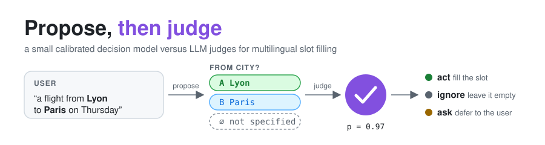
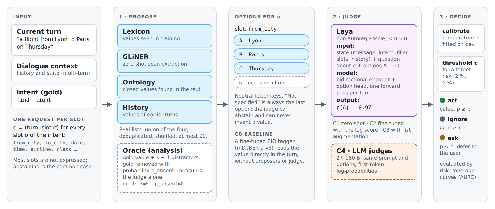
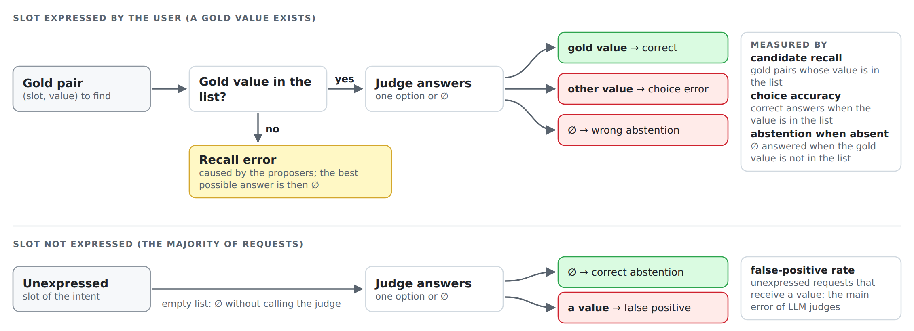
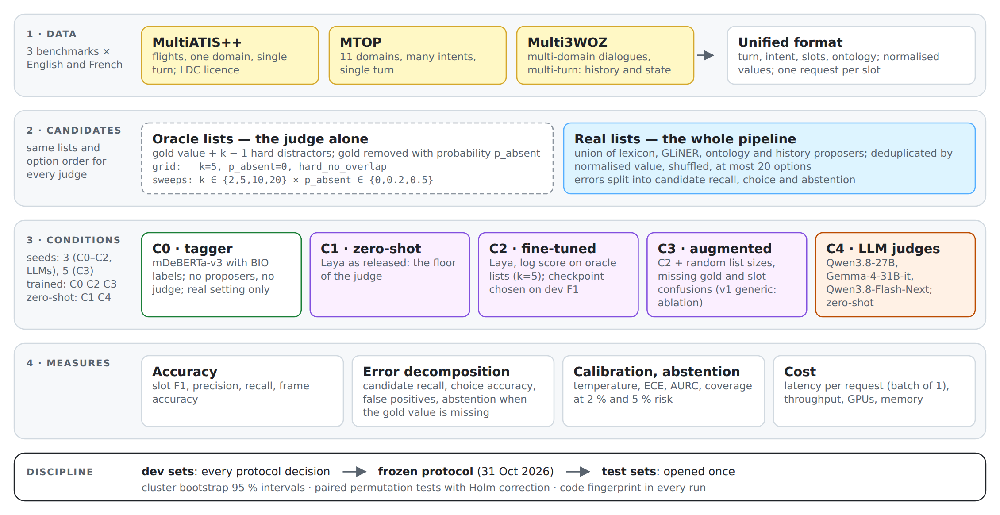

<p align="center">
  
</p>

<p align="center">
  <a href="https://github.com/ChristopheCruz/propose-then-judge-slots/actions/workflows/tests.yml"></a>
  
  
  <a href="https://hal.science/hal-05850913"></a>
  <a href="https://christophecruz.github.io/mypage.github.io/projets/lamae/"></a>
</p>

# Propose, then judge

**A small calibrated decision model versus large language model judges for multilingual slot filling.**
Code, configurations, results and LaTeX sources of the paper:

> Christophe Cruz, Hussam Ghanem, Hocine Cherifi. *Propose, then judge: a small calibrated decision model versus large language model
> judges for multilingual slot filling.* Preprint, HAL [hal-05850913](https://hal.science/hal-05850913), 2026.

**In one paragraph.** In a task-oriented assistant, inexpensive extractors **propose** candidate values
for each slot, and a **judge** picks one candidate or answers "not specified" — so it can never invent a
value. We ask whether a **small, fine-tuned and calibrated decision model** (Laya, < 0.5 B parameters)
can play this judge better than **large LLM judges** (27–180 B). On three public benchmarks, in English
and French, it does: it is far more accurate, mostly because it abstains when the user said nothing, its
confidence tells reliably when it may act alone, and it is several times cheaper. A plain fine-tuned
tagger, however, beats the whole pipeline when values are literal words of the utterance: the judge is
best seen as the **decision layer on top of extraction**, and its quality depends on its proposers.

## Contents

- [What are slots?](#what-are-slots)
- [Aim of this work](#aim-of-this-work)
- [How it works](#how-it-works) · [How Laya works](#how-laya-works) · [The baseline: a BIO tagger](#the-baseline-a-bio-tagger)
- [Experimental design](#experimental-design)
- [Main findings](#main-findings) · [Application domains](#application-domains)
- [Installation](#installation) · [Data](#data) · [Quick start](#quick-start) · [Reproducing the paper](#reproducing-the-paper)
- [Results files](#results-files) · [Repository layout](#repository-layout)
- [Paper](#paper) · [Licence](#licence) · [Funding](#funding) · [Citation](#citation)

## What are slots?

A task-oriented assistant (booking a flight, setting a reminder, finding a restaurant) must turn each
user message into a structured request: an **intent** (what the user wants) and the values of its
**slots** (the parameters of that intent). *Slot filling* is the task of finding, for every slot of the
current intent, the value the user expressed — or deciding that the user expressed none.

```text
User:  "I need a flight from Lyon to Paris on Thursday morning"

intent: find_flight
  departure city   →  Lyon
  arrival city     →  Paris
  date             →  Thursday
  time of day      →  morning
  airline          →  not specified      ← most slots are NOT expressed: abstaining is the common case
  class            →  not specified
```

Three things make the task harder than it looks, and our three benchmarks cover them:

| Difficulty | Example | Benchmark |
|---|---|---|
| **Abstention**: most slots of an intent are not mentioned, and filling them is an error | 94 % of the slot requests on MultiATIS++ have no value | MultiATIS++ |
| **Many intents and slots** across several domains | reminders, messaging, music, weather, … | MTOP |
| **Dialogue**: values come from earlier turns, or must be mapped to a canonical form | *"the same area as the hotel"*; French *"prix cher"* → `expensive` | Multi3WOZ |

## Aim of this work

LLMs are now routinely used as **judges** that pick one option among several, for evaluation, tool
selection or agent decisions. In an interactive system such a judge is called many times per user turn,
so two properties matter as much as accuracy: its **cost**, and whether its **confidence** tells the
system reliably when it may act on its own and when it should ask the user.

We ask whether a **small decision model, fine-tuned for this one decision and calibrated**, can replace
a large LLM judge. Slot filling is a convenient test bed: errors can be decomposed exactly (was the right
value proposed? was it chosen? did the judge abstain when it should?), public multilingual benchmarks
exist, and the decision "fill / leave empty / ask" is the one a real assistant takes.

The study is organised around five research questions:

| | Question |
|---|---|
| **RQ1** Efficiency | Is a fine-tuned small judge as accurate as an LLM judge, at a fraction of the cost? |
| **RQ2** Error decomposition | How much error comes from the proposers (candidate recall) and how much from the judge (choice, abstention), as lists get longer or the right value is missing? |
| **RQ3** Generalisation | Does the judge transfer from English to French? |
| **RQ4** Abstention | After calibration, can the judge decide most requests alone at a low, controlled risk? |
| **RQ5** Training | Does augmenting the option lists during training make the judge robust to a changing context? |

## How it works

<p align="center"></p>
<p align="center"><em><b>Figure 1.</b> The proposer–judge architecture, on one request: the slot <code>from_city</code> of the turn “a flight from Lyon to Paris on Thursday”.</em></p>

- **Input** — one request is issued for every slot of the intent; most of these slots are not expressed, so abstaining is the common correct answer.
- **1 · Propose** — four inexpensive proposers (lexicon of training values, GLiNER, ontology, dialogue history) build the *real* candidate list. For analysis, an *oracle* builds a list around the gold value with k − 1 distractors and removes the gold value with probability p_absent, which measures the judge alone.
- **Options** — candidates appear under neutral letter keys, followed by “not specified” (∅). The distractor *Thursday* is the value of another slot of the same turn: the typical trap of real lists.
- **2 · Judge** — Laya reads the dialogue state, the question about the slot and the options, and returns a probability per option in a single forward pass. In C4, an LLM judge is scored on the same options from the log-probabilities of its first answer token.
- **3 · Decide** — after temperature scaling on development data, a threshold τ chosen for a target risk turns the answer into *act* (fill the slot), *ignore* (leave it empty) or *ask* (defer to the user).
- **C0** — a fine-tuned BIO tagger, the classical alternative, reads the value directly in the turn without proposers or judge.

The same pipeline in plain text:

```text
  utterance          proposers        candidate list        judge              decision (calibrated p, threshold τ)
 ─────────────      ───────────      ────────────────      ─────────────      ────────────────────────────────────
 "a flight from ──►  lexicon    ──►   A  Lyon         ──►   Laya: one    ──►   value, p ≥ τ  →  act     fill the slot
  Lyon to Paris      GLiNER           B  Paris              forward pass       ∅,     p ≥ τ  →  ignore  leave it empty
  on Thursday"       ontology         ∅  not specified      picks A, p=0.97    p < τ         →  ask     defer to the user
                     history
```

Because the judge can only return one of the proposed candidates or "not specified", it never invents a
value, and every error falls into exactly one class:

<p align="center"></p>
<p align="center"><em><b>Figure 2.</b> Error decomposition: each request ends in exactly one outcome.</em></p>

For a slot the user expressed (top), either the gold value is missing from the list — a *recall* error of
the proposers, for which abstaining is the best possible answer — or it is present and the judge picks it
(correct), picks another value (*choice* error) or abstains wrongly. For an unexpressed slot (bottom),
the majority of requests, the judge must answer ∅ and any value is a *false positive*. The measures on
the right separate what the proposers miss (candidate recall) from what the judge gets wrong.

## How Laya works

[Laya](https://huggingface.co/convaiinnovations/laya) is a small **decision model**: given a situation and a
multiple-choice question, it returns a probability for every option in a single forward pass. It does not
write text; it chooses.

**Input** — a structured *state* and one or more *questions*. For the slot `from_city` of our example:

```text
STATE
  last_user_message     : "a flight from Lyon to Paris on Thursday"
  intent                : find_flight
  history               : (previous turns, in dialogue)
  slots_already_filled  : (known values, in dialogue)

QUESTION
  Which value does the user's last message give for the slot "from_city" (departure city)?
  A: Lyon
  B: Paris
  C: Thursday
  D: not specified: the last message gives no value for this slot
```

Options carry neutral letter keys and are shuffled with a fixed seed, because Laya, like LLM judges, has a
position bias. The "not specified" option is always present, so the judge can abstain.

**Model** — a bidirectional encoder (the `multilingual` checkpoint is built on mmBERT-base, about 322 M
parameters; the English one on ModernBERT-large). It reads the state, the question and the options at once,
and a decision head attached to marker tokens in front of each option turns the encoding into a probability
distribution: `A: Lyon 0.97 · B: Paris 0.01 · C: Thursday 0.01 · D: ∅ 0.01`. All the questions of a turn
(one per slot) share one forward pass.

| | Laya | LLM judge (Qwen, Gemma, …) |
|---|---|---|
| How it decides | encodes everything, then scores the options | generates text token by token; we read the probability of the first token (the option letter) |
| Size | < 0.5 B parameters | 27–180 B |
| Output | one probability per option, by design | a by-product of generative training |
| Measured cost | ≈ 8 ms per request, < 2 GiB of GPU memory | 25–50 ms per request, one or two full H200 GPUs |

**What this work adds**:

- **Zero-shot (C1)**, Laya cannot do the task: it almost always picks a value, even when the user said nothing (slot F1 ≈ 0.03).
- **Fine-tuning (C2)** with the *log score* — the log-probability of the correct option, including ∅ when the slot is not expressed — on 43,000 to 189,000 training questions built by the same code as the evaluation. This strictly proper scoring rule rewards honest probabilities. (Laya's original reinforcement-learning training code is not released.)
- **Augmentation (C3)**: during training, list sizes vary, the gold value is sometimes removed, and values of other slots are added as distractors, which makes the judge robust to real candidate lists.
- **Calibration and decision**: a temperature fitted on development data, then a threshold τ that turns the probability into *act*, *ignore* or *ask*.

In short, Laya is a "System 1" model — a fast, one-glance decision among given options. Once fine-tuned and
calibrated, it chooses as well as large LLMs when the right value is present, and it abstains far better.

## The baseline: a BIO tagger

The classical way to fill slots, and our baseline **C0**, is a **sequence tagger**: a model that reads the
utterance word by word and gives each word a label saying whether it belongs to a slot value.

- **B-slot** (*Begin*): the word starts a value of this slot;
- **I-slot** (*Inside*): the word continues that value;
- **O** (*Outside*): the word belongs to no value.

```text
word    I  need  a  flight  from  New          York         to  Paris      on  Thursday
label   O  O     O  O       O     B-from_city  I-from_city  O   B-to_city  O   B-date
```

The values are read off the labels: `from_city = New York`, `to_city = Paris`, `date = Thursday`; slots with
no label stay "not specified". Our tagger is mDeBERTa-v3-base (278 M parameters) fine-tuned for 10 epochs on
the gold spans, in the spirit of JointBERT; it labels a whole utterance, all slots at once, in one pass.

| | BIO tagger (C0) | Propose, then judge (Laya) |
|---|---|---|
| Where the value comes from | a span of the current turn | a candidate list built from the turn, the history, the ontology… |
| Values that are not literal words of the turn (history, canonical forms such as *"prix cher"* → `expensive`) | impossible | possible |
| Confidence usable to decide whether to act or ask | not designed for it | yes, calibrated |

**Why the tagger wins on MultiATIS++ and MTOP but loses on Multi3WOZ.** A tagger can only *underline words
of the current sentence*: the value it returns is always a piece of that sentence, copied as is.

| Situation | Example | Tagger (C0) | Propose, then judge |
|---|---|---|---|
| The value is a word of the sentence | "a flight from **Boston** to Denver on Monday" → `boston` | ✅ excellent | ✅ good |
| The value was given in an earlier turn | earlier: "… the restaurant **Sitar Tandoori**"; now: "I also need a taxi to **the restaurant**" → taxi destination `sitar tandoori` | ❌ impossible: the name is not in the sentence | ✅ the *history* proposer offers it |
| The value is a canonical form, different from the user's words | French "un restaurant **cher**" → `expensive`; "il me faut **cinq tickets**" → `5` | ❌ it underlines "cher", counted wrong | ✅ the *ontology* proposer offers `expensive` |

On MultiATIS++ and MTOP, values are almost always words of the sentence, so the tagger excels
(test F1 0.83–0.95). In the Multi3WOZ development set, **27 %** of the gold values (English) and **63 %** (French)
fall into the second or third case — in French, canonical values stayed in English (`expensive`, `centre`…)
while users speak French. The tagger necessarily misses them: test F1 0.73 (EN) and 0.38 (FR), against 0.85
and 0.59 for the pipeline with Laya.

The two are complementary: the tagger can become one of the judge's proposers, the most direct next step.

## Experimental design

<p align="center"></p>
<p align="center"><em><b>Figure 3.</b> Experimental protocol: data, candidate lists, conditions, measures and the development/test discipline.</em></p>

Three span-annotated benchmarks, in English and French, are converted to one format with one request per
slot (1). Every judge sees the same candidate lists in the same order: **oracle** lists isolate the judge
(grid setting, and sweeps over the list size k and the missing-gold rate p_absent), **real** lists from
the four proposers measure the whole pipeline (2). Five conditions are compared (3) on four families of
measures (4). Every protocol decision was taken on development sets; the protocol was then frozen
([`docs/protocole_test.md`](docs/protocole_test.md)) and each test set opened once.

**Datasets** (examples are user turns; for Multi3WOZ, the five domains play the role of intents):

| Dataset | Language | Train | Dev | Test | Intents | Slots | Turns | Licence |
|---|---|---:|---:|---:|---:|---:|---|---|
| MultiATIS++ | EN / FR | 4,478 / 4,465 | 500 | 893 | 18 | 83 | single | LDC (not redistributed) |
| MTOP | EN / FR | 15,667 / 11,814 | 2,235 / 1,577 | 4,386 / 3,193 | 113 / 110 | 75 / 73 | single | CC BY-SA 4.0 |
| Multi3WOZ | EN / FR | 49,395 / 49,394 | 6,267 | 6,266 | 5 domains | 30 | multi | MIT |

**Conditions:**

| Code | Judge | Training | Seeds |
|---|---|---|---|
| C0 | BIO tagger (mDeBERTa-v3-base, 278 M), no proposers, no judge | fine-tuned, 10 epochs | 3 |
| C1 | Laya, published `multilingual` checkpoint | zero-shot | 3 |
| C2 | Laya | fine-tuned with the log score on oracle lists (k = 5), 3 epochs | 3 |
| C3 | Laya | as C2, plus option-list augmentation that mimics slot confusions | 5 |
| C4 | Qwen3.8-27B, Gemma-4-31B-it, Qwen3.8-Flash-Next-FP8 (180 B MoE) | zero-shot, vLLM, one prompt | 3 |

All checkpoints are selected on development data. Statistics: 95 % cluster bootstrap intervals
(utterances, or dialogues for Multi3WOZ) and paired permutation tests with Holm correction.

## Main findings

> **Test-set results** of the frozen protocol ([`docs/protocole_test.md`](docs/protocole_test.md)): a single
> pass after every decision had been taken on development data; means over 3 seeds (5 for C3).

Slot F1 on the test sets (Laya: best of C2 and C3; LLM: best of the three judges):

| Dataset | Lang. | Laya, oracle lists | LLM, oracle lists | C0 tagger | Laya, real lists | LLM, real lists |
|---|---|---:|---:|---:|---:|---:|
| MultiATIS++ | EN | **0.941** | 0.427 | **0.949** | 0.829 | 0.531 |
| MultiATIS++ | FR | **0.925** | 0.383 | **0.923** | 0.832 | 0.556 |
| MTOP | EN | **0.953** | 0.753 | **0.904** | 0.695 | 0.583 |
| MTOP | FR | **0.951** | 0.753 | **0.833** | 0.629 | 0.529 |
| Multi3WOZ | EN | **0.946** | 0.844 | 0.733 | **0.853** | 0.762 |
| Multi3WOZ | FR | **0.919** | 0.753 | 0.380 | **0.592** | 0.474 |

Bold: best among the judges with oracle lists, and best system with real lists (C0 has no oracle setting).

- **The small judge is far more accurate than the LLM judges** — on every dataset and language, with oracle and real lists. All 72 paired comparisons of slot F1 and false-positive rate between fine-tuned Laya and the three LLMs are significant in its favour (Holm-corrected permutation tests).
- **LLM judges choose well but do not abstain.** When the right value is in the list, all judges pick it about equally often on MultiATIS++; the LLMs, however, fill 15–21 % of the slots the user never mentioned with oracle lists (fine-tuned Laya: 0.4–0.5 %; 0.4–0.7 % with real lists, against about 7 % for the LLMs).
- **Its confidence is usable.** After temperature scaling, the area under the risk–coverage curve is 3 to 40 times lower than the LLMs'; at a 5 % target risk the small judge decides 39–100 % of the requests without asking, no LLM more than 1 % on MultiATIS++ and MTOP.
- **It is cheaper**: 3–6 times faster per request (about 8 ms against 25–50 ms) and 5–38 times higher batch throughput, on a fraction of one GPU (< 2 GiB).
- **The judge is only as good as its candidates.** The tagger beats the pipeline when values are literal spans of the utterance (MultiATIS++, MTOP); the pipeline wins on dialogue (Multi3WOZ), where 27 % (EN) and 63 % (FR) of the gold values are not literal spans of the turn.
- **Augmentation must mimic real confusions.** Random option lists make the judge robust on synthetic tests but worse on real candidates; reproducing the confusions of real proposers gives robustness without cost.
- **Transfer.** Without French training data, the judge loses 0.04–0.09 F1 in French with oracle lists.

## Application domains

**Evaluated in this work.** Air travel (MultiATIS++: flights, fares, schedules, airlines, airports);
personal assistants (MTOP, 11 domains: alarm, calling, event, messaging, music, news, people, recipes,
reminder, timer, weather); and task-oriented dialogue for tourism services (Multi3WOZ, 5 domains:
restaurant, hotel, attraction, train, taxi) — in English and French.

**Where the approach applies** (not evaluated here). The core contribution is a small, calibrated judge
that chooses among proposed options or abstains, and whose confidence decides between *act*, *ignore*
and *ask*. It fits any frequent, well-defined decision that can be supervised:

- **assistants and service chatbots** — booking, customer service, support, appointment scheduling;
- **form filling and information extraction** from e-mails, tickets or reports — choose the right value among those proposed by extractors, or flag that it is missing;
- **AI agents** — select a tool or the value of a tool argument, and know when to act alone and when to ask for confirmation;
- **replacing LLM judges** in pipelines where a large model arbitrates between options, at a fraction of the cost;
- **multilingual systems** — the judge works in English and French with in-language training data;
- **frugal or on-premise deployment** — under 2 GiB of GPU memory, shareable with the other components.

The three-zone decision is most useful where a wrong action costs more than a question to the user
(health, finance, public administration, bookings). In every case, the judge is only as good as its
candidates: strong proposers — for instance a fine-tuned tagger when values are literal spans — remain
necessary.

## Installation

Linux, Python 3.11–3.12, [uv](https://docs.astral.sh/uv/), and NVIDIA GPUs for the experiments. The
paper used one machine with 2 × H200 NVL: Laya and the tagger need a fraction of one GPU, the LLM judges
one GPU (27–31 B) or two (180 B). The environment is locked in `uv.lock` and the model revisions in
`MODELES.lock.json`.

```bash
git clone https://github.com/ChristopheCruz/propose-then-judge-slots.git
cd propose-then-judge-slots
make preparer        # first call creates .env from .env.exemple (set HF_HOME, LLM_MODEL…), then stops
make preparer        # environment, models -> $HF_HOME, data, CPU tests
make tests           # CPU tests: no network, no GPU, no model
make aide            # list of all targets
```

Runs are executed offline (`HF_HUB_OFFLINE=1`). Every run records a fingerprint of the source and
configuration files (`code_sha256`); the final runs of the paper have
`code_sha256 = d80bc7ce063551bc01533296775fdada56634d8b6a53360eb604e4941ba46856`
(`make version` prints the fingerprint of your copy).

## Data

- **MTOP** (CC BY-SA 4.0) and **Multi3WOZ** (MIT) are downloaded and converted by `make donnees`.
- **MultiATIS++** (LDC2021T04) is distributed by the Linguistic Data Consortium and is **not
  redistributed here**, nor is anything that contains its text (predictions, converted data,
  checkpoints). With an LDC licence, place the TSV files under `data/raw/multiatis/` before
  `make donnees`; the SHA-256 of the converted files are checked against the manifests.

## Quick start

A small end-to-end run on MTOP English (open data), on one GPU, in a few minutes:

```bash
make entrainer-c2 DATASET=mtop LANGUE=en SEED=13                             # fine-tune Laya (C2)
make c2 DATASET=mtop LANGUE=en SEED=13 SPLIT=dev ARGS="data.limit=200"       # oracle lists
make c2 DATASET=mtop LANGUE=en SEED=13 SPLIT=dev CAND=reels ARGS="data.limit=200"   # real lists
cat results/c2-dev-mtop-en-s13-*/metrics.json | head -40
```

## Reproducing the paper

> **Use the tag [`paper-v1`](https://github.com/ChristopheCruz/propose-then-judge-slots/tree/paper-v1)** to
> reproduce the paper: its code has exactly the fingerprint of the frozen protocol
> (`code_sha256 d80bc7ce…`, checked by `scripts/test_final.sh`). Later commits add the multilingual model
> `laya-slotjudge-m46` (MASSIVE and SGD loaders, mixed training), which changes that fingerprint.

| Step | Command |
|---|---|
| Fine-tune Laya (C2, C3) | `make entrainer-c2 DATASET=<multiatis\|mtop\|multi3woz> LANGUE=<en\|fr> SEED=<13…>` (`entrainer-c3v2` for C3) |
| Fine-tune the tagger (C0) | `make entrainer-c0 DATASET=… LANGUE=… SEED=…` |
| Evaluate one condition | `make <c0\|c1\|c2\|c3v2\|c4-dev\|c4-alt2\|c4> DATASET=… LANGUE=… SEED=… SPLIT=<dev\|test> [CAND=reels]` |
| Sweeps over k × p_absent | `make balayage COND=c2 DATASET=multiatis LANGUE=en SEED=13 SPLIT=dev` |
| Request-by-request latency | `scripts/latence.sh` |
| Final test grid (frozen protocol) | `scripts/test_final.sh <gpus> <L\|A\|c4-dev\|c4-alt2\|c4>` |
| Intervals and tables | `make intervalles && make tableaux` → `results/tableau.{csv,tex}` |
| Calibrated decision | `uv run python -m experiments.decision --dev results/<dev run> --test results/<test run>` |
| Paired comparisons (Holm) | `make comparer PAIRES="<run A> <run B> …"` |
| Figures of results | `uv run python -m experiments.figures --split test --out docs/article/figures` |

The LLM judges are set in `.env` (`LLM_MODEL`, `LLM_MODEL_DEV`, `LLM_MODEL_ALT2`). Any configuration key can
be overridden on the command line: `ARGS="data.limit=200 judge.batch_size=64"`. Fine-tuning takes minutes
for the single-turn datasets and about one hour per seed for the largest training set on one H200; the full
LLM test grid takes about a day on two H200.

## Results files

Each run writes one folder under `results/`:

| File | Content |
|---|---|
| `config.yaml` | fully resolved configuration (dataset, language, split, seed, candidates, judge) |
| `metrics.json` | slot precision / recall / F1, frame accuracy, error decomposition, latency, throughput, `code_sha256`, data hashes |
| `ci.json` | 95 % cluster bootstrap intervals of the metrics |
| `decision.json` | calibration (temperature, ECE), risk–coverage curve, AURC, thresholds and coverage at target risks |
| `run.log` | log of the run |

Final test runs are named `results/final-*`. Runs marked with an `OBSOLETE` file (early exploratory runs
on the MultiATIS++ English test split, before the frozen protocol) are kept for transparency and are
ignored by all tables and figures. **Predictions** (`predictions.jsonl`, one line per request with the full
probability vector) of the MTOP and Multi3WOZ test runs are attached as archives to the GitHub release
[`test-results-2026-11-01`](https://github.com/ChristopheCruz/propose-then-judge-slots/releases/tag/test-results-2026-11-01),
under the licence of the source dataset; MultiATIS++ predictions are not distributed.

## Repository layout

| Path | Content |
|---|---|
| `laya_slots/data/` | loaders and conversion of the three benchmarks to a unified format (`schema.py`) |
| `laya_slots/candidates/` | candidate generators: oracle with controlled distractors, lexicon, GLiNER, ontology, history, BIO tagger |
| `laya_slots/judges/` | judges: Laya (zero-shot / fine-tuned), LLM judges served by vLLM, rule baselines |
| `laya_slots/train/` | fine-tuning of Laya by the log score on items produced by the inference code |
| `laya_slots/decision/` | temperature and isotonic calibration, three-zone decision, risk–coverage |
| `laya_slots/evaluation/` | metrics (F1, frame accuracy, error decomposition), cluster bootstrap, permutation tests |
| `experiments/` | entry points: `run.py` (one run), `train.py`, `train_tagger.py`, `decision.py`, `intervalles.py`, `tables.py`, `figures.py` |
| `configs/` | conditions C0–C4 (`conditions/`), candidate settings (`candidats/`), training (`train/`) |
| `scripts/` | the run series of the paper (`test_final.sh`, `relance_dev.sh`, `c0.sh`, `latence.sh`, `transfert.sh`, `phase2*.sh`) |
| `figures/schemas/` | diagrams of the paper: SVG sources, PNG for this README, and their generator |
| `results/` | one folder per run (see [Results files](#results-files)) |
| `docs/article/` | LaTeX sources of the paper (Elsevier CAS template), with all its figures in `docs/article/figures/`; bibliography in `docs/article/references.bib` |
| `docs/protocole_test.md` | the frozen protocol of the final test runs, written before the test sets were opened |
| `docs/journal_fr.md` | research log (in French): every run series, decision and incident, in chronological order |
| `tests/` | CPU tests without network or model (synthetic fixtures) |

Some folder names, comments and the research log are in French (`entrainer` = train, `donnees` = data,
`reels` = real, `balayage` = sweep, `intervalles` = intervals); the code, configurations and results are
self-describing.

## Paper

The LaTeX sources of the manuscript are in [`docs/article/`](docs/article/) (`main.tex`, one file per
section in `sections/`):

```bash
cd docs/article && pdflatex main && bibtex main && pdflatex main && pdflatex main
```

This is a **working draft**: all results are final test-set results, and red `[TODO]` marks open items
(missing references, author decisions). All figures of the paper are in `docs/article/figures/`: the diagrams
(PDF, from `figures/schemas/`) and the result plots (pgfplots, generated by
`uv run python -m experiments.figures --split test --out docs/article/figures`).

## Licence

Code: MIT, © 2026 Université Bourgogne Europe (see [`LICENSE`](LICENSE)). The manuscript in
`docs/article/` is © the authors, all rights reserved until publication; the Elsevier CAS class files keep
their own licence (LPPL). Data, models and predictions keep the licences of their sources (see
[`NOTICE`](NOTICE)).

## Funding

<a href="https://christophecruz.github.io/mypage.github.io/projets/lamae/"></a>

This work was supported by the French National Research Agency (ANR) through the LabCom LAMAE project
[grant number ANR-24-LCV1-0008] and the CAIRE project [grant number ANR-23-CMAS-0031], which funded the
computing infrastructure (a server with two NVIDIA H200 NVL GPUs).
<br clear="left">

## Citation

If you use this code, please cite the paper (HAL preprint; the reference will be updated if the paper is published; see also
[`CITATION.cff`](CITATION.cff)):

```bibtex
@unpublished{cruz2026proposejudge,
  author      = {Cruz, Christophe and Ghanem, Hussam and Cherifi, Hocine},
  title       = {Propose, then judge: a small calibrated decision model versus large language model
                 judges for multilingual slot filling},
  year        = {2026},
  note        = {Preprint},
  url         = {https://hal.science/hal-05850913},
  hal_id      = {hal-05850913},
  hal_version = {v1}
}
```

Contact: Christophe Cruz (corresponding author), Laboratoire Interdisciplinaire Carnot de Bourgogne (ICB), UMR 6303 CNRS,
Université Bourgogne Europe, Dijon, France.
